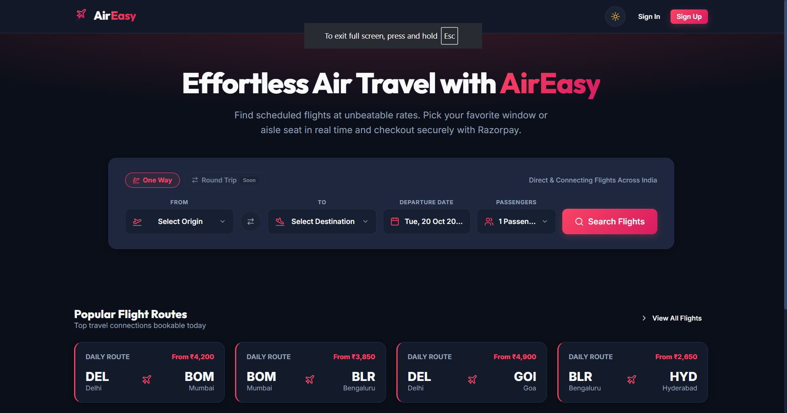
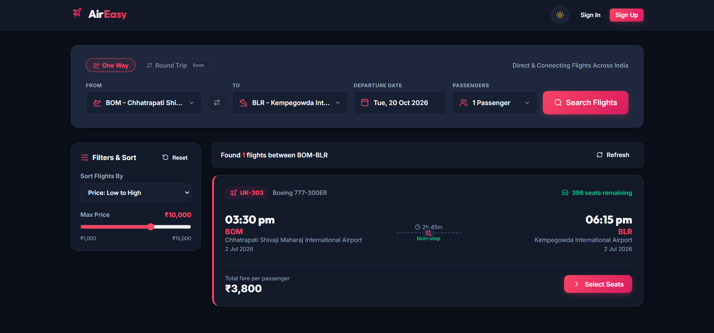
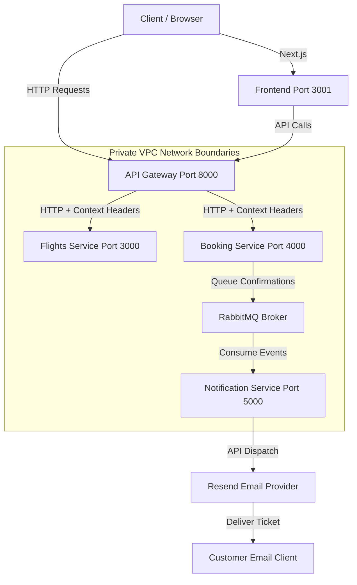
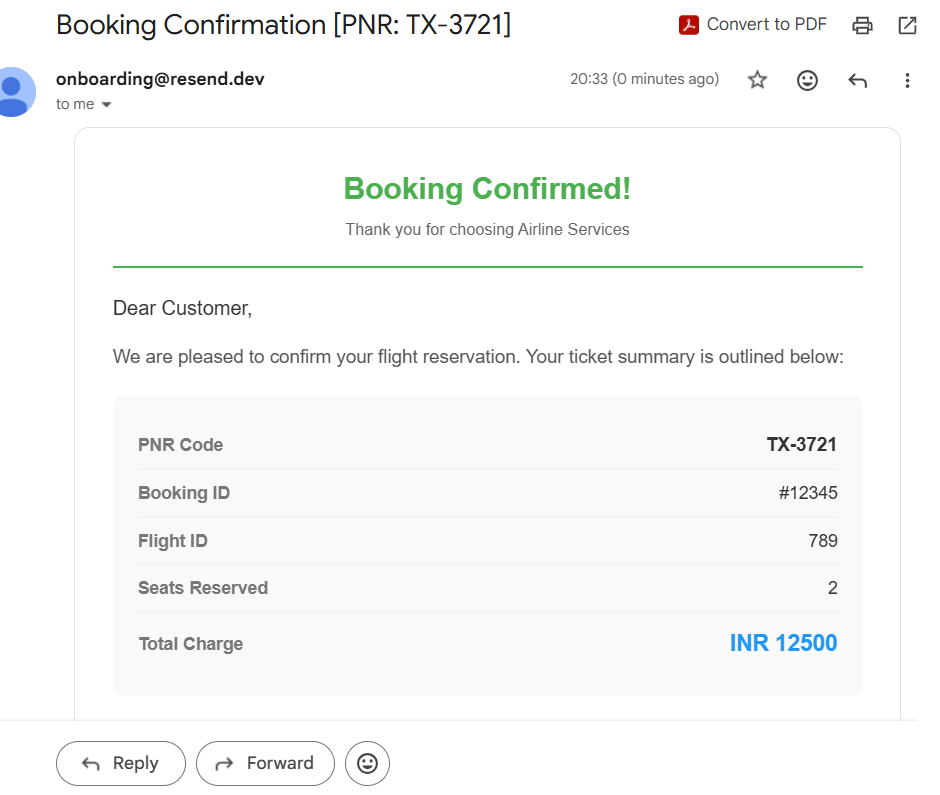

# AirEasy — Airline Reservation System

A flight booking and transaction processing system built on a  microservices architecture with a modern web frontend.

The backend leverages an API Gateway for request routing and stateless security enforcement, uses RabbitMQ for asynchronous event-driven task processing, and integrates with the Resend API for transactional email dispatching. The frontend provides an intuitive booking experience with live seat selection and Razorpay payment integration.




---
<br/>



---

## System Architecture



---

## Architectural Coverage

1. **Centralized Edge Proxy**: The API Gateway acts as the single entry point. It handles centralized JWT validation, evaluates user roles, and forwards requests to target services.
2. **Stateless Role-Based Access Control (RBAC)**: Supports roles including ADMIN, CUSTOMER, and FLIGHT_COMPANY. Role permissions are checked statelessly at the Gateway level using JWT claims.
3. **Network Boundary Hardening**: Microservices are configured using Docker internal exposure (`expose` rather than `ports`). This blocks external direct host access to port 3000 and port 4000, forcing all client requests through the Gateway.
4. **Gateway Context Injection**: The API Gateway intercepts requests, resolves user identities, and injects authenticated variables (`x-user-id` and `x-user-email`) into the forwarded HTTP headers. This prevents user ID spoofing attacks at the edge.
5. **Asynchronous Messaging**: Upon successful payment, the booking service pushes seat confirmations to RabbitMQ. The notification service processes queue events statelessly to decouple email dispatch latency from the booking transaction thread.
6. **Decoupled Templates**: Email layouts (HTML structure and CSS styles) are decoupled from the notification dispatch logic and organized inside a dedicated template module.

---

## Technology Stack

### Backend Microservices

| Service | Port | Core Stack |
|---------|------|------------|
| API Gateway | 8000 (Public) | Node.js, TypeScript, Express.js, JWT, Prisma, PostgreSQL |
| Flights Service | 3000 / 50051 (gRPC) | Node.js, TypeScript, Express.js, gRPC, Prisma, PostgreSQL |
| Booking Service | 4000 (Internal) | Node.js, TypeScript, Express.js, gRPC Client, RabbitMQ, Prisma, PostgreSQL |
| Notification Service | 5000 (Internal) | Node.js, TypeScript, Express.js, RabbitMQ Consumer, Resend API |

### Frontend

| Component | Stack |
|-----------|-------|
| Framework | Next.js 16, React 19, TypeScript |
| Payments | Razorpay Sandbox Integration |
| UI | Custom component library, Lucide Icons |

---

## Local Execution Guide

### Prerequisites
* Docker Desktop installed and running.
* Node.js 18+ (for the frontend).

### Execution Steps

1. **Clone the Repository**:
   ```bash
   git clone <repository_url>
   cd Airline-backend
   ```

2. **Configure Environment variables**:
   Create a `.env` file inside the `notification-service/` directory and populate your Resend credentials:
   ```env
   RESEND_API_KEY=re_your_api_key_here
   SENDER_EMAIL=onboarding@resend.dev
   ```

3. **Build and Start Backend Services**:
   From the repository root folder, run:
   ```bash
   docker-compose up --build -d
   ```
   This will build the Node.js/TypeScript stack, execute database migrations, seed standard database roles, start RabbitMQ, and launch the service containers internally.

4. **Start the Frontend**:
   ```bash
   cd frontend
   npm install
   npm run dev
   ```
   The frontend will be available at `http://localhost:3001`.

5. **Health Check**:
   Confirm the backend stack is active by sending a request to the Gateway health endpoint:
   ```bash
   curl http://localhost:8000/api/v1/info
   ```

---

## Production Deployment Specifications

### 1. Zero-Trust VPC Network
* Keep microservice port exposures blocked from the public internet.
* Run all microservices on private subnets. Only the API Gateway should be reachable via an external Application Load Balancer (ALB).
* Downstream services trust `x-user-id` and `x-user-email` headers, as they can only be injected by the gateway within the private network perimeter.

### 2. High-Performance Internal Communication (gRPC)
* For low-latency inter-service queries, transition internal communications from HTTP/REST to gRPC over HTTP/2. The flights service includes preconfigured protocol buffers (`src/protos/flights.proto`) and an active gRPC server class to handle fast binary serialization.

### 3. Managed Middleware
* Replace the local database container and local RabbitMQ broker with managed cloud alternatives (such as AWS RDS PostgreSQL and Amazon MQ or CloudAMQP) to ensure high availability and automatic backups.

---

## Appendix: Booking Ticket Template

Upon processing a successful flight booking payment, the notification service sends the following HTML-formatted transactional ticket summary to the user's inbox:

